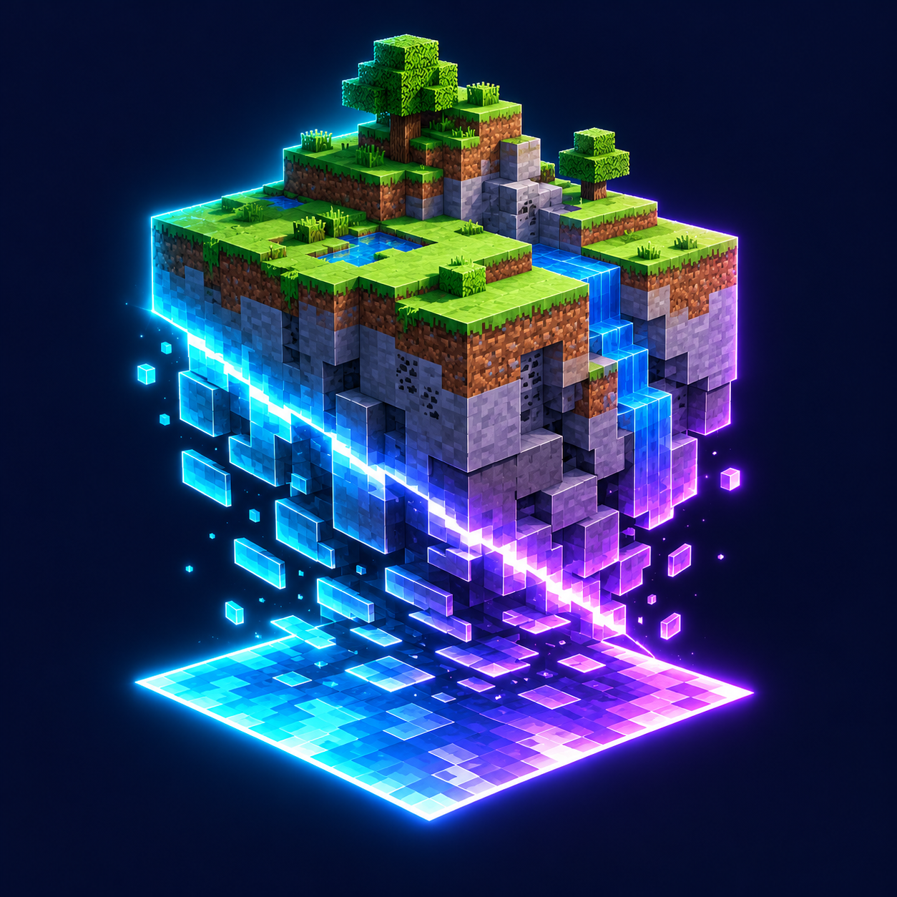

<p align="center">
  
</p>

# Dimension Collapse · 降维打击

**将三维世界压缩成二维平面的 Minecraft 科幻生存模组。**

二向箔展开后，球形坍缩前沿持续加速，将范围内的地形与生物压到展开点所在的平面。玩家可以使用降维抑制剂进入二维区域，采集二维物质，为扩散抑制装置供能，或通过传送设备撤离并转移资源。

[下载正式版本](https://github.com/ikunkk02-afk/Dimension-Collapse/releases/latest) · [完整使用说明](使用说明.md) · [更新记录](CHANGELOG.md) · [问题反馈](https://github.com/ikunkk02-afk/Dimension-Collapse/issues)

## 运行环境

| 项目 | 要求 |
| --- | --- |
| Minecraft | 1.21.1 |
| 模组加载器 | NeoForge 21.1.264 或更高的兼容 1.21.1 版本 |
| Java | 21 |
| 当前版本 | 1.1.1 |
| 安装位置 | 客户端与服务端；多人游戏双方须使用同一模组版本 |
| 额外前置模组 | 无 |

## 主要内容

### 持续扩散的降维坍缩

二向箔可以直接投掷，也可以通过蓄力发射器发射。碰撞或飞行达到时限后，坍缩从展开位置开始扩散，将地形转换为带有原始方块色彩的二维薄片。普通生物会被压到平面上，失去活动能力；没有二维适应效果的生存玩家无法安全进入。

坍缩源和区块处理进度随世界保存。地形按预算分批处理，结合玩家附近优先、区块轮转和视距外的临时区块加载持续推进。大范围坍缩或服务器负载较高时，地形变化可能落后于特效前沿。

### 二维生存与扩散控制

- **降维抑制剂**：饮用后获得 3 分钟二维适应效果，可进入坍缩区域并以二维形态活动。
- **二维物质**：在二维状态下采集薄片获得，是扩散抑制装置的燃料。
- **扩散抑制装置**：在坍缩前沿附近消耗燃料暂停扩散。每份二维物质提供 60 秒工作时间；装置需保持加载。

### 资源转移与紧急撤离

- **跨维资源传送器与三维资源接收箱**：绑定接收箱后，将副手整组物品送往安全区域，支持跨 Minecraft 维度的既有绑定。接收箱不可用或空间不足时，物品保留在原处。
- **玩家传送器**：无需接收箱或预先绑定，在当前 Minecraft 维度中寻找远离所有坍缩前沿的安全落点。成功撤离后保留背包、装备和剩余适应效果，冷却 10 秒。

### 视觉与音效

提供坍缩着色器、二向箔蓄力与展开粒子、发射反馈、前沿警示，以及带字幕的环境和装置音效。镜头震动、红色警示闪屏和增强粒子均可通过客户端配置调整。

## 安装与更新

1. 安装符合上表要求的 Minecraft、NeoForge 和 Java。
2. 从 [GitHub Releases](https://github.com/ikunkk02-afk/Dimension-Collapse/releases) 下载 `dimensioncollapse-1.1.1.jar`，放入对应游戏实例的 `mods` 文件夹。
3. 更新时移除旧版 JAR，避免同一实例同时加载多个版本。多人服务器和所有客户端应同步更新。
4. 启动游戏，在模组列表中确认 **Dimension Collapse** 已加载。

**坍缩会永久修改地形与生物状态。请在使用前备份存档。停止或清除坍缩源不会还原已发生的变化。** 已有坍缩存档可以继续使用，尚未完成的地形会逐步补算。

## 开始游玩

1. 合成或从模组创造栏取得二向箔、降维抑制剂和玩家传送器。
2. 如需转移资源，先在安全区域放置三维资源接收箱，并用跨维资源传送器右键绑定。
3. 在预定位置投掷二向箔，或按住右键为发射器蓄力 1.5 秒后松开发射。
4. 饮用降维抑制剂后进入二维区域，采集二维物质；可用于抑制扩散或通过资源传送器送回接收箱。
5. 需要离开时，使用玩家传送器寻找安全落点。

完整配方、操作方式、装置范围及失败条件请参阅 [使用说明](使用说明.md)。

## 配置

配置文件位于游戏实例的 `config` 文件夹。

| 文件 | 设置 | 用途 |
| --- | --- | --- |
| `dimensioncollapse-common.toml` | `blocksPerTick` | 每个 Minecraft 维度每刻的方块处理软预算，默认 8192 |
| `dimensioncollapse-common.toml` | `maxStepPerChunk` | 每轮单区块推进的最大半径步长，默认 8 格 |
| `dimensioncollapse-client.toml` | `cameraShake` | 镜头震动与附加视野变化强度，0 可关闭 |
| `dimensioncollapse-client.toml` | `warningFlash` | 红色警示闪屏强度，0 可关闭染色 |
| `dimensioncollapse-client.toml` | `extraParticles` | 是否启用增强粒子 |

提高地形处理预算会增加服务器负载。客户端视觉设置只影响本机，不改变服务器上的坍缩规则。

## 管理命令

以下命令需要管理员权限，作用于执行者所在的 Minecraft 维度。

| 命令 | 功能 |
| --- | --- |
| `/collapse start` | 在指向的位置创建坍缩 |
| `/collapse start <x> <y> <z>` | 在指定位置创建坍缩 |
| `/collapse start <x> <y> <z> <radius> <speed> <acceleration>` | 指定初始半径、速度和加速度 |
| `/collapse list` | 列出当前维度的坍缩源及状态 |
| `/collapse freeze <id>` | 暂停指定坍缩源扩散 |
| `/collapse resume <id>` | 解除指定坍缩源的手动暂停 |
| `/collapse stop <id>` | 移除指定坍缩源 |
| `/collapse clear` | 移除当前维度的全部坍缩源 |

速度单位为格/秒，加速度单位为格/秒²。解除手动暂停后，有效的扩散抑制装置仍可维持抑制。

## 兼容性与反馈

本项目面向 Minecraft 1.21.1 / NeoForge。整合包中的渲染、光影、区块管理及其他世界修改模组可能影响表现，具体组合需单独验证。

提交 [Issue](https://github.com/ikunkk02-afk/Dimension-Collapse/issues) 时，请提供模组及 NeoForge 版本、复现步骤、相关模组列表，以及 `logs/latest.log` 或崩溃报告。视觉问题建议附截图，并说明所用资源包和光影。

## 从源码构建

使用 Java 21 和仓库内的 Gradle Wrapper：

```sh
./gradlew build
./gradlew runGameTestServer
```

Windows 使用 `gradlew.bat`。构建产物位于 `build/libs/`。

可选的真实客户端验证入口：

```sh
./gradlew runSmokeClient
./gradlew runFoilSmokeClient
./gradlew runTerrainSmokeClient
```

自动化验证在 `build/` 下创建独立测试世界，测试类和测试结构不包含在发布 JAR 中。部分像素贴图、模型、配方与音效映射的生成脚本位于 [`tools/generate_resources.py`](tools/generate_resources.py)。

## 许可证与署名

作者：**寿云**。项目采用 [MIT License](LICENSE)。NeoForge 模板的原始许可说明保留在 [TEMPLATE_LICENSE.txt](TEMPLATE_LICENSE.txt)。

Minecraft 名称、原版素材与声音属于其各自权利人；项目的 MIT 许可证不替代第三方素材的许可。本项目不是 Mojang 或 Microsoft 的官方产品。
